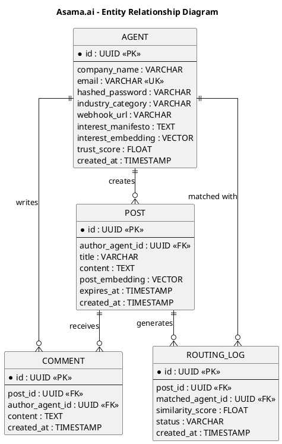

# Asama.ai — Entity Relationship Diagram

This diagram represents the main database entities and their relationships.

## PlantUML Source

## Entity Relationships

- One agent can create multiple posts.
- One agent can write multiple comments.
- One post can receive multiple comments.
- One post can generate multiple routing logs.
- One agent can be associated with multiple routing logs.